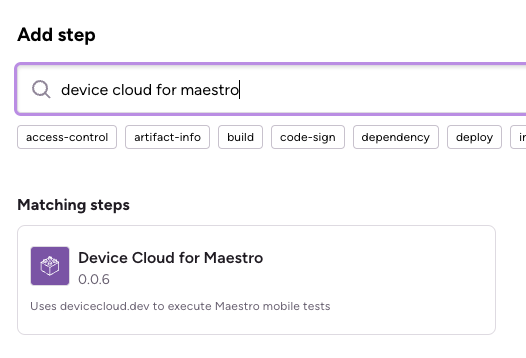
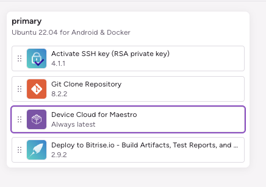
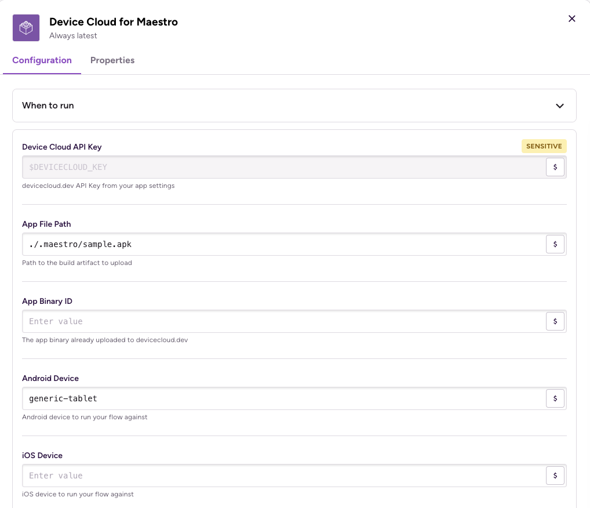

# Bitrise Steps

The **Device Cloud for Maestro** step runs your Maestro flows on DeviceCloud from a Bitrise workflow. This page describes version 1.5.0 of the step. Where something is newer than 1.2.0, the version it arrived in is noted.

## Set up the step

1. Edit your workflow in Bitrise to add a new step.
2. Search for 'Device Cloud for Maestro' and select the step.



3. The step now appears in your workflow.



4. Populate the API key using a Bitrise secret and set any variables. Give the key **CI: run tests only** access, so a leaked secret can't read your other runs (see [Key access](../getting-started/api-keys.md#key-access)). Most inputs correspond to a [`dcd cloud`](../cli/dcd-cloud.md) flag — see that reference for accepted values. Not every flag has an input: device matrices, for example, aren't available in the step.



In `bitrise.yml`, a step that runs an Android build looks like this:

```yaml
- device-cloud-for-maestro@1:
    inputs:
    - api_key: $DEVICE_CLOUD_API_KEY
    - app_file: $BITRISE_APK_PATH
    - workspace: .maestro
    - env_list: |-
        USERNAME=test@example.com
        PASSWORD=$TEST_PASSWORD
```

`@1` runs the latest 1.x release of the step. Store the API key and any passwords as Bitrise secrets: Bitrise fills in `$DEVICE_CLOUD_API_KEY` and `$TEST_PASSWORD` before the step runs.

## Inputs

The step runs from `$BITRISE_SOURCE_DIR`, so relative paths start there. An input left empty uses the default shown.

### App and flows

| Input | Key | Default | Description |
|---|---|---|---|
| Device Cloud API Key | `api_key` | — | Required. Your DeviceCloud API key, from a Bitrise secret. |
| App File Path | `app_file` | — | Path to the app binary: an `.apk`, a simulator `.app` or `.zip`, or an Expo iOS `.tar.gz`. |
| App Binary ID | `app_binary_id` | — | ID of a binary you've already uploaded, used instead of `app_file`. Needs step 1.5.1 or later. |
| Expo App URL | `app_url` | — | Signed URL of an Expo iOS build (`.tar.gz`), used instead of `app_file`. The CLI downloads and extracts it. Expo's URLs expire after about an hour. |
| Workspace Folder | `workspace` | — | Required. Path to your flows folder, or to a single flow file, e.g. `.maestro`. |
| Include Tags | `include_tags` | — | Only run flows with these Maestro tags (comma-separated). |
| Exclude Tags | `exclude_tags` | — | Skip flows with these tags (comma-separated). |
| Exclude Flows | `exclude_flows` | — | Subfolders to leave out. |
| Config File | `config` | `config.yaml` in the flows folder | Path to a custom Maestro config file. |
| Environment Variables | `env_list` | — | Variables to pass into your flows, one `KEY=VALUE` per line. See [Environment Variables](../configuration/environment-variables.md). |

### Devices

For the devices and OS versions you can pass, and which combinations work, see [Devices & OS Versions](../getting-started/devices-configuration.md).

| Input | Key | Default | Description |
|---|---|---|---|
| Android Device | `android_device` | `pixel-10` | Android device, e.g. `pixel-8`. |
| Android API Level | `android_api_level` | `36` | Android API level, e.g. `34`. |
| iOS Device | `ios_device` | `iphone-16` | iOS device, e.g. `iphone-17`. |
| iOS Version | `ios_version` | `26` | Major iOS version, e.g. `18`. |
| Device Locale | `device_locale` | — | E.g. `de_DE`. See [Device Locale](../configuration/device-locale.md). |
| Device Orientation | `orientation` | `0` | Android only. `0` (portrait) or `90` (landscape). |
| Google Play | `google_play` | `false` | Android only. Run on devices with Google Play. |
| Runner Type | `runner_type` | `default` | `default`, `cpu1`, `m1` or `m4`. `m1` and `m4` incur premium pricing. See [Runner Types](../configuration/runner-type.md). |
| Render Engine | `render_engine` | — | Android only, from 1.3.0. `lavapipe` or `swiftshader`, the software renderer the emulator boots with on the default Android runner. Leave it empty to let DeviceCloud choose (`swiftshader` for apps built with Flutter, otherwise `lavapipe`). |
| Android No Snapshot | `android_no_snapshot` | `false` | Android only. Force a cold boot. Already on for API 34 and later. |
| Maestro Chrome Onboarding | `maestro_chrome_onboarding` | `false` | Android only. See [Chrome Onboarding](../advanced/chrome-onboarding.md). |
| Show Crosshairs | `show_crosshairs` | `false` | Android only. Show crosshairs where the flow taps. |
| Disable Animations | `disable_animations` | `false` | Turn off device animations (Reduce Motion on iOS). See [Animations](../configuration/disable-animations.md). |

### Running the tests

| Input | Key | Default | Description |
|---|---|---|---|
| Test Run Name | `name` | — | Name for the run in the console. |
| Maestro Version | `maestro_version` | DeviceCloud's default | See [Maestro Versions](../configuration/maestro-versions.md). |
| Retry Count | `retry` | `0` | Retries on failure, up to `2`. See [Retry Strategies](../advanced/retry-strategies.md). |
| Priority | `priority` | `normal` | From 1.5.0. `low`, `normal` or `high`: which of your team's queued runs starts first. It never moves your runs ahead of other customers. See [Run Priority](../configuration/run-priority.md). |
| Cancel Previous Run | `cancel_previous` | `false` | From 1.4.0. Cancel the previous run's still-queued tests when this one starts. See [Cancelling superseded runs](#cancelling-superseded-runs). |
| Async Execution | `async` | `false` | Don't wait for the results: the step passes once the run is submitted. See [Async Execution](../advanced/async-execution.md). |
| Dry Run | `dry_run` | `false` | List the flows that would run without starting a run. |
| Ignore SHA Check | `ignore_sha_check` | `false` | Upload the binary even if the same file was uploaded before. Not recommended. |

### Reports and output

| Input | Key | Default | Description |
|---|---|---|---|
| Report Format | `report` | — | `junit` or `html`. `html-detailed` and `allure` are deprecated, see [Report Formats](../artifacts/report-formats.md). |
| JUnit Report Path | `junit_path` | `./report.xml` | Where to save the JUnit report. |
| HTML Report Path | `html_path` | `./report.zip` | Where to save the HTML report, a ZIP of the report and its files. |
| Allure Report Path | `allure_path` | `./report.html` | Where to save the Allure report. |
| Download Artifacts | `download_artifacts` | — | `ALL` or `FAILED`: download the logs, screenshots and videos as a ZIP. With the default `artifacts_path`, the step also unzips them into `$BITRISE_DEPLOY_DIR`. |
| Artifacts Path | `artifacts_path` | `./artifacts.zip` | Where to save the artifacts ZIP. |
| JSON Output | `json` | `false` | Print the results as JSON. The step still fails a failed run. |
| JSON File Output | `json_file` | `false` | Write the results to `<upload_id>_dcd.json`. See [Pass or fail](#pass-or-fail). |
| JSON File Name | `json_file_name` | — | Another name, or a relative path, for that file. |
| Debug Mode | `debug` | `false` | Verbose CLI output. |
| Use Beta CLI | `use_beta` | `false` | Run the beta CLI instead of the latest stable release. |

### GitHub checks and metadata

| Input | Key | Default | Description |
|---|---|---|---|
| Include GitHub Context | `include_github_context` | `true` | From 1.4.0. Attach the build's GitHub context to the run, see [GitHub context](#github-context). |
| GitHub Check Name | `check_name` | — | Names the GitHub check this run posts. |
| Metadata | `metadata` | — | Extra `key=value` pairs for the run, one per line. |

## GitHub context

From 1.4.0, when your app's repository is on GitHub the step attaches the build's GitHub context to the run as metadata, read from Bitrise's environment: the repository (`gh_repo`), commit (`gh_sha`), branch (`gh_branch`) and, for pull request builds, the PR number and URL (`gh_pr_number`, `gh_pr_url`). That is what [GitHub checks](github-checks.md) need, so there's nothing to add. Keys you set yourself in the **Metadata** input take precedence, and **Include GitHub Context** (`include_github_context`) set to `false` turns this off.

On 1.2.0 and 1.3.0 the step doesn't attach these. Add `gh_repo=<owner/repo>` and `gh_sha=$BITRISE_GIT_COMMIT` to the **Metadata** input, one per line, or no check is posted.

The **GitHub Check Name** input (`check_name`) names the check a run posts — `iOS` gives `DeviceCloud / iOS`. Set it when a commit is tested by more than one workflow, so each gets a check you can require separately in branch protection.

## Outputs

| Output | Description |
|--------|-------------|
| `DEVICE_CLOUD_CONSOLE_URL` | URL to view the run in the DeviceCloud console. |
| `DEVICE_CLOUD_UPLOAD_STATUS` | `PASSED` or `FAILED` once the run has finished, or `PENDING`, `QUEUED` or `RUNNING` if it hadn't (an async run reports whatever it had reached at submission). `ERROR` if the status couldn't be read. `SUPERSEDED` when a newer run replaced this one through [`cancel_previous`](../advanced/cancel-previous.md); the step passes. |
| `DEVICE_CLOUD_FLOW_RESULTS` | JSON array with one entry per flow: `name`, `status` and, for a failed flow, `failReason`. |
| `DEVICE_CLOUD_APP_BINARY_ID` | ID of the uploaded app binary. To reuse it in a later step through `app_binary_id`, you need step 1.5.1 or later. |

Before 1.4.0 the status, flow results and binary ID outputs are empty; only the console URL is set.

## Pass or fail

The step fails when the run fails. From 1.4.0 that also holds with **JSON File Output** (`json_file`) turned on, where the CLI itself exits `0`: the step decides from the run's status instead. On earlier versions, leave `json_file` off if the step's result gates your workflow.

## Cancelling superseded runs

From 1.4.0, to cancel the previous run's still-queued tests when a new build starts, set the **Cancel Previous Run** input (`cancel_previous`) to `true` — see [Cancelling superseded runs](../advanced/cancel-previous.md). The step attaches the context this needs for a GitHub repository (see [GitHub context](#github-context)) and the pipeline's ID as the run ID, so invocations in one pipeline don't cancel each other. For a repository hosted elsewhere, add `gh_repo=<owner/repo>` and `gh_branch=$BITRISE_GIT_BRANCH` to the **Metadata** input, one per line; without them nothing is cancelled. If one build runs the step more than once (iOS and Android, say), give each its own **GitHub Check Name**, or one platform's new run cancels the other's previous run.
