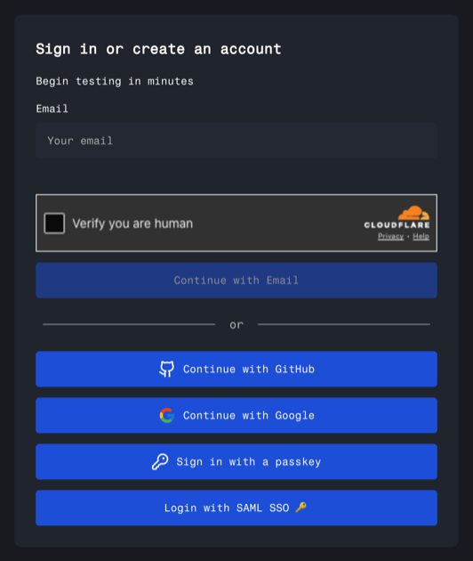

# Enterprise SSO

::: info
Enterprise SSO is available on the Max and Enterprise plans.
:::

Single sign-on solutions (such as Okta) allow organisations to centrally manage user access to DeviceCloud.

We support the following identity providers:

* Okta
* Auth0
* Google Workspace
* Microsoft Entra ID (formerly Azure Active Directory) and Active Directory Federation Services (AD FS)
* PingIdentity
* OneLogin

Using a provider that isn't on the list? Contact us and we'll help you set it up.

## Integration Steps

These steps have been written with Okta in mind, but are applicable to other identity providers too.

1. Create a new application with SAML in Okta
2. Populate the SAML fields using the below values.

| Key                          | Value                                                     |
| ---------------------------- | --------------------------------------------------------- |
| Single sign-on URL (ACS URL) | `https://cloud.devicecloud.dev/auth/v1/sso/saml/acs`      |
| Audience URI (SP Entity ID)  | `https://cloud.devicecloud.dev/auth/v1/sso/saml/metadata` |
| Default Relay State          | `https://console.devicecloud.dev/login`                   |

The Default Relay State is where people land when they start from your identity provider's dashboard, for example from an Okta tile.

3. Ensure the application username is set to EMAIL
4. Ensure the Name ID Format is set also to EMAIL
5. Generate your metadata URL (or XML file for some providers)
6. Send the following to support@devicecloud.dev from an email address registered with DeviceCloud:
   1. your metadata URL (or XML)
   2. the email domain(s) you wish to protect
7. Our support team will then verify your team is on the Max or Enterprise plan and enforce SSO for the requested domains.
8. Once SSO is on, sign in from the [DeviceCloud login screen](https://console.devicecloud.dev/login): enter your work email, then select **SAML SSO**. You can also start from your identity provider's dashboard.

## What changes once SSO is on

* People with an email address on a protected domain must sign in with **SAML SSO**. The login screen turns away an email code, GitHub, Google or a passkey for those addresses.
* Assign everyone who needs access to the DeviceCloud app in your identity provider before SSO is turned on. Anyone on a protected domain who isn't assigned can't sign in.
* People who sign in through SSO for the first time join your team automatically.
* Your identity provider handles multi-factor authentication. SSO accounts don't set up DeviceCloud two-factor authentication or passkeys, and an SSO sign-in meets every team [Sign-in requirement](security-overview.md#sign-in-and-two-factor-authentication).
* API keys keep working as before.
